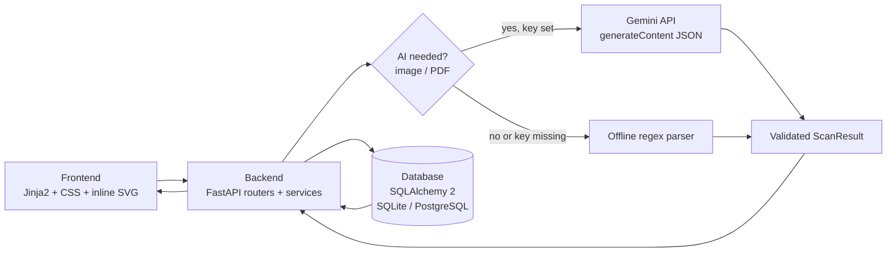

# Architecture

FinPulse AI is a single-process web app. The browser talks to FastAPI, which owns the business rules; Gemini is an optional step inside the receipt service; SQLite (or PostgreSQL) is the only source of truth.

## Request flow

`routers/web.py` renders four server-side pages, while `routers/api.py` exposes the same operations as JSON. Both call `services/ledger.py`, which validates input through Pydantic schemas, derives line-item and invoice totals, and commits through a short-lived SQLAlchemy session from `db.py`.

Receipt uploads go through `services/receipts.py`. With `GEMINI_API_KEY` set, the service sends the extracted text to Gemini's `generateContent` endpoint and validates the returned JSON into a `ScanResult`. Any network error, malformed reply or missing key falls back to the deterministic regex parser, so the app is never blocked by an outage. Users review the extracted fields before `scan/save` creates an expense.

`services/analytics.py` aggregates invoices and expenses into monthly buckets and category slices, and `services/charts.py` turns those into SVG strings. Charts are rendered on the server, so there is no JavaScript chart library or CDN request.

`services/seed.py` inserts 14 invoices and 18 expenses with `random.Random(42)` when `SEED_ON_START=1`. The seed is idempotent and marks its rows with `source="seed"`, so `clear_seed()` can remove them without touching your data. Configuration comes only from environment variables in `.env`.
