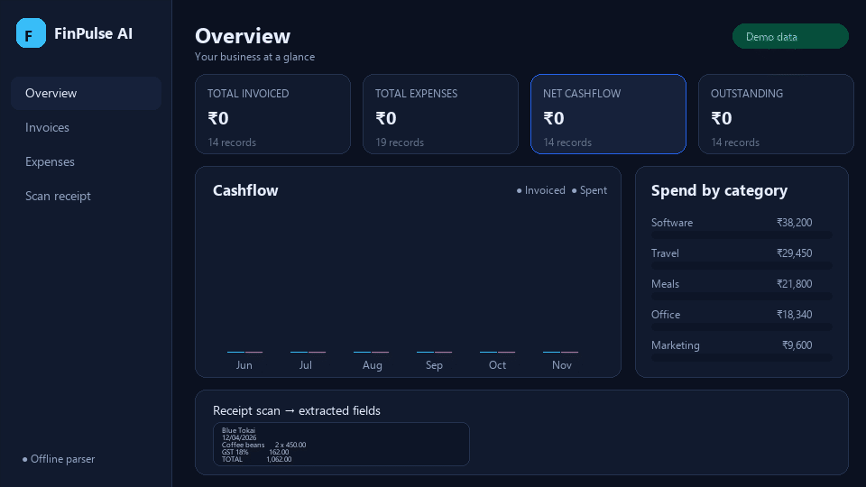

<div align="center">


# FinPulse AI

**An open-source AI receipt scanner and invoice manager for freelancers.**

[](https://github.com/priyanshkk/finpulse-ai/actions)
[](LICENSE)
[](docker-compose.yml)
[](pyproject.toml)
[](https://github.com/priyanshkk/finpulse-ai/releases)

**[Live demo](https://priyanshkk.github.io/finpulse-ai/demo/)** — open it and click **Continue as Guest**. No signup, no API key.

</div>

## See it in 12 seconds



*Upload a receipt, extract its fields, watch the charts update.*

## Why this exists

Freelancers lose hours chasing invoices and typing receipts into spreadsheets. FinPulse AI keeps both sides of that ledger in one self-hosted app, with an AI scanner you can switch off.

- **⚡ Instant OCR** — upload a PDF or image and extract merchant, tax, items and totals.
- **🧾 Invoice ledger** — numbered invoices, line items, due dates and paid/pending/overdue status.
- **📊 Live dashboards** — dependency-free SVG charts for cashflow and spend by category.
- **🔐 Private by default** — self-hosted SQLite; your receipts never leave your machine.
- **🤖 Optional Gemini** — add one API key for image OCR; the offline regex parser always works.
- **🐳 Two-minute setup** — one `docker compose up` gives you 14 sample invoices and 18 expenses.

## Tech stack

| Layer | Tools |
| --- | --- |
| Backend | FastAPI, Uvicorn, Pydantic |
| Data | SQLAlchemy 2, SQLite (PostgreSQL via `DATABASE_URL`) |
| UI | Jinja2, server-rendered SVG charts, vanilla JS/CSS |
| AI | Gemini `generateContent` API (optional), regex fallback |
| Quality | pytest, Ruff, mypy, GitHub Actions |

## Quick start

```bash
git clone https://github.com/priyanshkk/finpulse-ai.git
cd finpulse-ai
cp .env.example .env          # Windows: copy .env.example .env
docker compose up -d
```

Open **http://localhost:8000**. The dashboard is seeded automatically; remove `SEED_ON_START=1` from `.env` for an empty ledger. See [docs](docs/index.md) for local Python setup and API examples.

## Roadmap

- [x] Receipt scanner with offline fallback
- [x] Invoice and expense CRUD with derived totals
- [x] Seed data, SVG charts and Docker Compose
- [ ] CSV and PDF export for invoices
- [ ] Multi-user workspaces with roles
- [ ] Recurring invoice scheduling

Contribute via [CONTRIBUTING.md](CONTRIBUTING.md); read [ARCHITECTURE.md](ARCHITECTURE.md) before changing the data layer.
